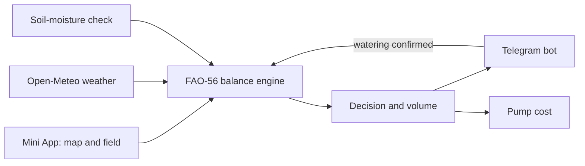
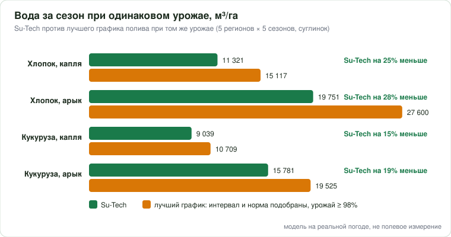
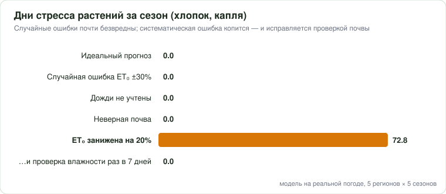

<div align="center">

# 💧 Su-Tech

**Explainable irrigation planning from the FAO-56 water balance — in Telegram, with a field map and a bench experiment**

[🤖 Telegram bot](https://t.me/Su_Tech_bot) · [🗺 Mini App](https://app8796056339.tgcloud.ai/) · [📈 Research](research/README.md) · [🧪 Experiment](experiment/PROTOCOL.md) · [Русский](README.md)

</div>

---

## What problem it solves

A farmer needs three answers: **irrigate now or wait, how much water to apply, and what the pump will cost**. Su-Tech takes weather and field parameters (crop, soil, irrigation method, crop age) and answers with every calculation step shown, so an agronomist can check it.

**Features**
- root-zone water balance (FAO-56: TAW, RAW, Kc, Ks);
- irrigate / wait decision and volume in m³;
- pump time, energy and cost;
- saved fields, daily updates, irrigation log;
- **soil-moisture check** (wet / normal / dry) that removes accumulated forecast error;
- Russian, Kazakh and English interface;
- a **jury demo**: `/demo`, step-by-step calculation.



## Research results

A computer study on **real weather** from five irrigated regions of Kazakhstan, 2021–2025. Su-Tech is compared with the **best possible** fixed irrigation calendar: interval and dose chosen to give the same yield (≥ 98% in every season) with the least water. Both strategies use the same irrigation method.

<p align="center"></p>

- At equal yield Su-Tech uses **15–28% less water**, in **25 of 25 seasons** for every crop/method combination; in the worst season the saving is 9–20%.
- Across two soil types and three planting dates (36 combinations) the saving is 14–42% and holds in every season.
- Against a plain calendar with the same mean dose Su-Tech uses 2–9% **more** water but has no stress days (the calendar has 38–65) and no deep-percolation loss. The saving only exists at equal yield, and should always be stated that way.
- Random forecast errors are nearly harmless; a **systematic** bias accumulates. A weekly soil-moisture check removes it:

<p align="center"></p>

> ⚠️ **This is model-versus-model, not a field measurement.** Weather is NASA POWER reanalysis for regional centres; yield is estimated with the FAO-33 relation. See [research/README.md](research/README.md) (Russian) for the method, limitations and how to reproduce.

## Validation

- Penman–Monteith ET₀ (`bot/et0.py`) reproduces FAO-56 Example 18 (Brussels, 6 July): 3.88 mm/day against a reference of about 3.9. Intermediate values are confirmed by an independent source; the final figure is still being checked against the printed book. See [docs/audits/VALIDATION.md](docs/audits/VALIDATION.md).
- The seasonal water balance closes to 10⁻¹² mm over all 500 simulation runs.
- The Python and JavaScript engines agree on 675 reference scenarios.

## Bench experiment

Arduino Uno with relay and pump, soil-moisture, water-level and temperature sensors, and a **pot scale (HX711)**. The scale gives ground truth: the pot's weight loss is the water the plant actually evaporated. Design: 12 pots, two groups (Su-Tech vs fixed calendar), 4–6 weeks, one-command analysis.

## Repository layout

| Path | Contents |
|---|---|
| [`serverless/`](serverless) | **Production bot** (Telegram Serverless, JavaScript), balance engine, tests |
| [`bot/`](bot) | Reference Python engine, ET₀, Arduino bridge, experiment log |
| [`research/`](research) | Simulation on real weather, sensitivity analysis, figures |
| [`experiment/`](experiment) | Protocol, data collection, analysis |
| [`firmware/`](firmware) | Bench firmware |
| [`frontend/`](frontend) | Mini App (submodule: [sutech-frontend](https://github.com/osmanri/sutech-frontend)) |

## Run the tests

```bash
git clone --recurse-submodules https://github.com/osmanri/sutech-core.git && cd sutech-core
python -m unittest tests.test_water_balance tests.test_water_stress tests.test_et0 tests.test_experiment tests.test_hardware_bridge tests.test_research_simulation
python -m research.simulate && python -m research.sensitivity && python -m research.plots   # offline, weather is cached
cd serverless && npm ci --ignore-scripts && npm test
```

## Status, honestly

| Item | Status |
|---|---|
| Bot, Mini App, calculation, demo | working |
| ET₀ and balance checked against FAO-56 | yes (Example 18 and tests); CROPWAT comparison **not done yet** |
| Water saving at equal yield | **model estimate**, not a measurement |
| Pot experiment | protocol and tools ready, **data still being collected** |
| Crop and soil parameters | project values, not a local calibration |
| Farm field trial | planned for the 2027 season |

## Authorship and AI

The idea, problem statement, method choices and the experiment are the author's. The code was written with an AI assistant (Claude Code); decisions about models, assumptions and verification are made and explained by the author. Sources: [FAO-56](https://www.fao.org/4/x0490e/x0490e00.htm) (Allen et al., 1998), FAO-33 (Doorenbos and Kassam, 1979), NASA POWER, Open-Meteo.

*NASA POWER data were obtained from the NASA Langley Research Center (LaRC) POWER Project funded through the NASA Earth Science/Applied Science Program.*
