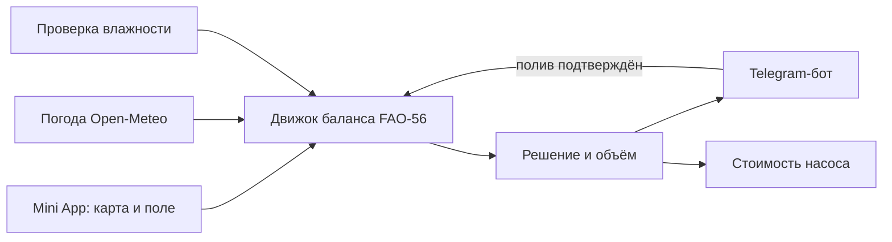
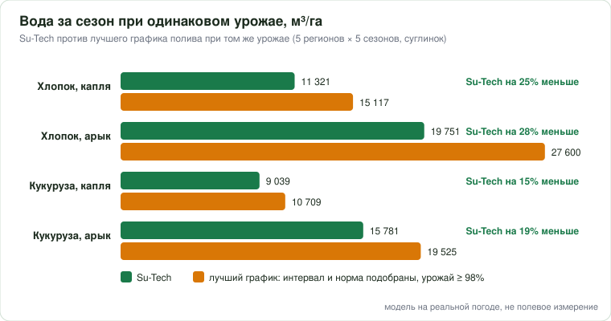
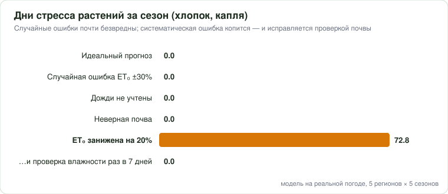

<div align="center">

# 💧 Su-Tech

**Объяснимое планирование полива по водному балансу FAO-56 — в Telegram, с картой поля и проверкой на стенде**

[🤖 Telegram-бот](https://t.me/Su_Tech_bot) · [🗺 Mini App](https://app8796056339.tgcloud.ai/) · [📈 Исследование](research/README.md) · [🧪 Эксперимент](experiment/PROTOCOL.md) · [English](README.en.md)

</div>

---


## Карта репозитория

| Папка / файл | Что там |
|---|---|
| `serverless/` | Живой бот (JavaScript на Telegram Serverless), его тесты, сборка Mini App |
| `frontend/` | Сайт и Mini App (отдельный репозиторий `sutech-frontend`, подключён как submodule) |
| `bot/` | Эталонный расчётный движок на Python (`water_balance.py`, `et0.py`), на нём считается исследование; старый Python-бот отключён |
| `crops/` | Каталог культур: единственный источник правды (`catalog.json`, `build.py`) |
| `research/` | Компьютерное исследование на реальной погоде и его результаты |
| `experiment/`, `firmware/` | Опыт с горшками (протокол, предрегистрация, сбор данных) и стенд на Arduino |
| `paper/` | Научная статья (черновик) и список литературы |
| `docs/` | Метод, сверка коэффициентов, планы, справка для агронома, материалы для презентации; `docs/audits/` старые аудиты, `docs/archive/` архив |
| `tests/` | Тесты Python (`python run_tests.py`); тесты бота лежат в `serverless/test/` |
| `scripts/windows/` | Удобные скрипты для Windows |
| `REPRODUCE.md`, `CHANGELOG.md`, `CITATION.cff`, `LICENSE` | Как воспроизвести, что менялось, как цитировать, лицензия (MIT) |

## Зачем это

Фермеру нужно знать три вещи: **поливать ли сейчас, сколько воды подать и сколько будет стоить работа насоса**. Su-Tech берёт погоду и параметры поля (культура, почва, способ полива, возраст растения) и отвечает на эти вопросы — с объяснением каждого шага, чтобы агроном мог проверить расчёт.

<table>
<tr>
<td width="50%">

**Что умеет**
- расчёт водного баланса корнеобитаемого слоя (FAO-56: TAW, RAW, Kc, Ks);
- решение «поливать / подождать» и объём в м³;
- время работы насоса, энергия и стоимость в ₸;
- сохранённые поля, ежедневное обновление, журнал поливов;
- **проверка влажности почвы** кнопкой «влажная / нормальная / сухая» — исправляет накопленную ошибку прогноза;
- **«Почему так?»** у каждого совета: уровень доверия, допущения, источники чисел, «а если мы ошиблись»;
- **режим эксперта**: агроном правит p, глубину корней и множитель Kc для поля, бот помечает «изменено вручную»;
- **самопроверка**: сравнение расчёта с ответами фермера «влажная / нормальная / сухая» по каждому полю;
- **короткая настройка из пяти вопросов** и экран «Мы предположили» с кнопками «Уточнить»;
- 🔔 у поля, где влажность не проверяли больше 7 дней (рассылки по расписанию платформа не умеет);
- интерфейс на русском, казахском и английском;
- **демо-режим** для жюри: `/demo`, расчёт по шагам.

</td>
<td width="50%">

**Как это устроено**



</td>
</tr>
</table>

## Результаты исследования

Компьютерное исследование на **реальной погоде** пяти орошаемых регионов Казахстана за 2021–2025 годы. Сравнивается Su-Tech и **лучший возможный** график полива: интервал и норма подобраны так, чтобы урожай был тем же (не ниже 98% в каждом сезоне), а воды уходило меньше всего. Способ полива у обеих стратегий одинаковый.

<p align="center"></p>

- При одинаковом урожае Su-Tech расходует **на 15–28% меньше воды**, в **25 сезонах из 25** для каждой комбинации; в худшем сезоне экономия 9–20%.
- На двух типах почв и трёх датах посева (36 комбинаций) экономия 14–42%, и она есть в каждом сезоне.
- Против обычного графика с той же средней нормой Su-Tech расходует на 2–9% **больше**, но без дней стресса (у графика 38–65 дней) и без потерь воды в глубину. Экономия появляется только при равном урожае — так её и нужно формулировать.
- Случайные ошибки прогноза почти безвредны, а **систематическая** ошибка копится. Её исправляет проверка влажности почвы раз в неделю:

<p align="center"></p>

> ⚠️ **Это модель против модели, а не полевое измерение.** Погода — реанализ NASA POWER для областных центров, урожай оценён по формуле FAO-33. Подробности, ограничения и воспроизведение — в [research/README.md](research/README.md). Проверка на живых растениях — в [experiment/PROTOCOL.md](experiment/PROTOCOL.md).

## Проверка расчёта

- ET₀ по Пенману–Монтейту (`bot/et0.py`) сверена с примером 18 из FAO-56 (Брюссель, 6 июля): получилось 3,88 мм/сут, эталон ≈ 3,9. Промежуточные величины подтверждены независимым источником, итоговое значение ещё сверяется с печатной книгой. См. [docs/audits/VALIDATION.md](docs/audits/VALIDATION.md).
- Водный баланс сезона замыкается с точностью 10⁻¹² мм на всех 500 прогонах.
- Движки на Python и JavaScript сверяются на 675 эталонных сценариях.

## Стенд и эксперимент

Arduino Uno с реле и помпой, датчиками влажности, уровня воды, температуры и **весами для горшков (HX711)**. Весы дают эталон: вес горшка показывает, сколько воды растение действительно испарило. Опыт: 12 горшков, две группы (Su-Tech и фиксированный график), 4–6 недель, анализ одной командой.

```bash
python experiment/collect.py --port COM7 --pots A1:sutech A2:sutech B1:control B2:control   # ежедневное взвешивание
python experiment/analyze.py data/log.csv --pot-area-cm2 177 --outcomes data/outcomes.csv     # RMSE, экономия, тест Уэлча
```

## Структура репозитория

| Папка / файл | Что внутри |
|---|---|
| [`serverless/`](serverless) | **Рабочий бот** (Telegram Serverless, JavaScript), движок баланса, тесты |
| [`bot/`](bot) | Эталонный движок на Python (`water_balance.py`), ET₀, мост к Arduino, журнал опыта |
| [`research/`](research) | Симуляция на реальной погоде, анализ чувствительности, графики |
| [`experiment/`](experiment) | Протокол опыта, сбор данных, анализ |
| [`firmware/`](firmware) | Прошивка стенда |
| [`frontend/`](frontend) | Mini App (подмодуль, репозиторий [sutech-frontend](https://github.com/osmanri/sutech-frontend)) |
| [`docs/`](docs/README.md) | Указатель документов |

## Запуск и тесты

```bash
git clone --recurse-submodules https://github.com/osmanri/sutech-core.git && cd sutech-core

# Python: расчёты, симуляция, эксперимент
python -m unittest tests.test_water_balance tests.test_water_stress tests.test_et0 tests.test_experiment tests.test_hardware_bridge tests.test_research_simulation

# Воспроизвести исследование (погода лежит в research/data, интернет не нужен)
python -m research.simulate && python -m research.sensitivity && python -m research.plots

# Бот (Node 22+)
cd serverless && npm ci --ignore-scripts && npm test
```

## Честно о статусе

| Что | Статус |
|---|---|
| Бот, Mini App, расчёт, демо | работают |
| ET₀ и баланс сверены с FAO-56 | да, по примеру 18 и тестам; сверка с CROPWAT — **не выполнена** |
| Экономия воды при равном урожае | **оценка по модели**, не измерение |
| Опыт с горшками | протокол и инструменты готовы, **данные ещё собираются** |
| Параметры культур и почв | значения проекта, не местная калибровка |
| Поле у хозяйства | планируется на сезон 2027 |

Использованные данные и источники: [FAO-56](https://www.fao.org/4/x0490e/x0490e00.htm) (Allen и др., 1998), FAO-33 (Doorenbos и Kassam, 1979), NASA POWER, Open-Meteo.

*Данные NASA POWER получены в рамках проекта POWER Центра Лэнгли (NASA LaRC), финансируемого программой Earth Science/Applied Science.*
