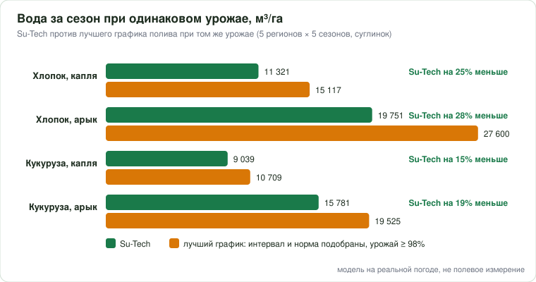
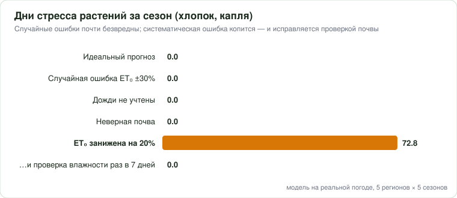

# Su-Tech: explainable irrigation scheduling from the FAO-56 water balance, with a closed-loop soil check

**Author:** Osman Tolobek · [school, city — to be filled in]
**Status:** DRAFT for the author's revision. Sections marked **[AUTHOR]** need the author's own text or data; the pot experiment (Section 4.5) has **no results yet**.

## Abstract

Irrigation decisions in southern Kazakhstan are made under tight water limits, yet farm-level scheduling tools remain hard to use for small farms. We present Su-Tech, a decision-support system that turns weather, crop, soil and irrigation-method data into a daily irrigate/wait decision, a water volume and a pump cost, and explains every calculation step in a Telegram chat. The core is the FAO-56 root-zone water balance with a water-stress coefficient Ks. We evaluate it in a retrospective simulation on real weather (NASA POWER, five irrigated regions, 2021–2025, cotton and maize, drip and furrow irrigation), comparing Su-Tech with fixed irrigation calendars that use the same irrigation method. Against the strongest fixed calendar — interval and dose optimised with hindsight so that every season keeps ≥ 98% relative yield — Su-Tech used **15–28% less water** (95% bootstrap intervals about ±2 percentage points; worst single location-season 9–20%) and had no days of crop water stress, in 25 of 25 location-seasons for each crop/method combination. Across two distinct soils and three planting dates (36 combinations) the saving was 14–42% and held in every season. Against an uncalibrated calendar with the same mean dose, Su-Tech used 2–9% *more* water, but avoided 38–65 days of stress per season; the saving therefore exists only when yield is held equal. A sensitivity analysis shows that random forecast errors are almost harmless, while a systematic −20% ET₀ bias causes 71–73 stress days per season; a weekly three-level soil-moisture check (wet / normal / dry), implemented in the bot, removes the stress and retains 14–17% saving. These results are model-versus-model; a bench experiment with weighed pots (protocol and tools included) is designed to test them.

**Keywords:** irrigation scheduling, FAO-56, water balance, decision support, Kazakhstan, closed-loop control.

## 1 Introduction

Southern Kazakhstan relies on the transboundary Syr Darya for irrigated agriculture, and in 2026 the government set regional water-consumption caps (Turkestan Region: 3.8 billion m³) and planned reductions of water-intensive crops [R7]. Under such limits the timing and dose of each irrigation matter for farmers and for the basin. Established tools exist — most notably FAO's CROPWAT [R2] — but they are desktop programs aimed at specialists, whereas a small farm needs a short answer on a phone: *irrigate now or wait, how much, and at what energy cost?*

**Research questions.** (1) At equal yield, how much water can daily FAO-56 water-balance scheduling save compared with fixed irrigation calendars in Kazakhstan's irrigated regions? (2) How robust is the decision to errors in the inputs (forecast ET₀, rainfall, soil type)? (3) Can a cheap farmer-supplied soil check correct systematic forecast error?

**Contribution.** (a) An open implementation of the FAO-56 balance with Ks in two languages of code (Python reference, JavaScript production) that agree on 675 reference scenarios; (b) a reproducible retrospective study on real weather with an equal-yield baseline; (c) a quantified failure mode (systematic ET₀ bias) and a remedy that is built into the product; (d) a bench-experiment protocol and tooling for ground-truth testing. The author's own part is described under *Author contribution and use of AI*.

## 2 Related work and gap

**FAO-56 and CROPWAT.** The FAO-56 guidelines [R1] define reference evapotranspiration (Penman–Monteith) and the dual-purpose crop coefficient and root-zone balance approach used here. CROPWAT 8.0 implements these procedures and builds irrigation schedules from a daily soil-water balance [R2]; one evaluation concluded it should not be used without calibrating crop coefficients to local conditions [R3]. The same calibration caveat applies to our crop and soil parameters.

**Mobile scheduling tools.** Smartphone applications built on FAO-56 exist: CropFit for cotton in the US Southeast delivers daily push notifications from a daily balance, and extension summaries report water reductions of up to 40–44% with yield gains [R4] (extension reports, not independently reviewed here); IrriMobile estimates ET₀ with neural networks for green maize and was found to overestimate irrigation requirements by 8–19% [R5]. A reported ET-based scheduling study in Central Asia found 32–35% water saving over two years [R6] (to be verified against the primary source). We found no published evaluation of a *messaging-bot* scheduling tool, nor one that evaluates a farmer-supplied soil check as a correction to forecast bias. *[Search log: paper/literature_log.md. A systematic search by the author is still needed before claiming novelty.]*

**Gap.** A step-by-step, explainable, phone-native tool for small farms in Kazakhstan, evaluated against an equal-yield baseline and with a quantified robustness analysis and built-in correction.

## 3 Methods

### 3.1 Water balance
For each day, root-zone depletion follows FAO-56 chapter 8:
`Dr,i = clamp(Dr,i−1 + ETc − Peff − I, 0, TAW)`, with `TAW = 1000 (θFC − θWP) Zr`, `RAW = p·TAW`, `ETc = Ks·Kc·ET₀` and, when `Dr > RAW`, `Ks = (TAW − Dr) / ((1 − p)·TAW)` (FAO-56 eq. 84, using start-of-day depletion). Water driven below `Dr = 0` is deep percolation. Effective rainfall is 0 below 5 mm and 0.75·P otherwise (a project simplification, not an FAO formula). Root depth grows linearly to the end of crop development. Su-Tech decides "irrigate" when depletion reaches `min(RAW, delivery-system threshold)` and applies the computed depletion; gross volume is `net / efficiency` (drip 0.90, furrow 0.50). Crop, soil and efficiency parameters are project values, not a local calibration.

### 3.2 ET₀ and weather
Daily weather comes from NASA POWER (2 m temperature, dew point, wind, all-sky shortwave radiation, precipitation) [R8] for the coordinates of five regional centres (Turkestan, Shymkent, Kyzylorda, Taraz, Taldykorgan), 2021–2025. ET₀ is computed with an own implementation of FAO-56 Penman–Monteith, which reproduces intermediate quantities of FAO-56 Example 18 (e_s = 1.997 kPa, R_a = 41.09 MJ m⁻² d⁻¹ confirmed against an independent implementation; final ET₀ 3.88 mm d⁻¹ against ≈ 3.9 in the paper — **[AUTHOR: verify against the printed book]**). The production bot takes ET₀ and rainfall from Open-Meteo [R9].

### 3.3 Retrospective simulation
The "truth" model is the balance of Section 3.1 on real weather (planting 1 May; cotton 195 d, maize 125 d; loam). Two strategies irrigate the same field with the same irrigation method:
* **Su-Tech:** the production engine, tracking its own deficit and never seeing the truth state.
* **Calendar:** a fixed net dose every N days, sized from the long-term mean crop demand of the same location. A **plain** calendar uses that dose. The **best calendar** — the main baseline — searches the interval (drip 1–7 d, furrow 5–21 d) and, for each interval, the smallest dose multiplier (bisection, tolerance 0.005) for which *every* season at that location reaches ≥ 98% relative yield; the combination with the least water wins. Both are chosen with hindsight of all five seasons, which favours the calendar (a farmer cannot know them in advance). An earlier version used a fixed 5-day (drip) or 10-day (furrow) interval; on sandy soil such a calendar cannot reach the yield target at any dose, which motivated the stronger baseline. Relative yield uses the FAO-33 relation `1 − Ya/Ym = Ky (1 − ETa/ETm)` [R10] with Ky = 0.85 (cotton) and 1.25 (maize).

The seasonal water balance closes to 10⁻¹² mm in all 500 runs. Su-Tech and calendar are compared as paired differences per location-season (25 per crop/method).

### 3.4 Sensitivity analysis
Su-Tech decides with a degraded forecast while the truth model uses real weather: random multiplicative ET₀ error (σ = 10, 20, 30%; 20 replicates, fixed seed), rainfall never forecast, wrong soil entered, and systematic ET₀ bias of ±20%. The bias scenario is repeated with a soil check that resets the app's deficit every 3 or 7 days, as the farmer's three-level judgement (wet = 0, normal = RAW/2, dry = RAW).

### 3.5 Robustness to soil and planting date
The best-calendar comparison is repeated for every combination of soil (sand, loam, clay), planting date (15 April, 1 May, 15 May), crop and irrigation method — 36 combinations of 25 location-seasons each (`research/robustness.py`).

### 3.6 Bench experiment (designed, not yet run)
Twelve pots, two groups assigned by lottery (Su-Tech vs fixed schedule), 4–6 weeks, a fast-growing crop. A load cell with an HX711 amplifier weighs each pot daily; evaporation is the weight loss corrected for added water. Outcomes: model accuracy (RMSE, MAE, bias of predicted vs weighed ET), total water per pot, dry mass, dry mass per litre; Welch's t-test and Cohen's d. Protocol: `experiment/PROTOCOL.md`; tools: `experiment/collect.py`, `experiment/analyze.py`.

## 4 Results

### 4.1 Water use at equal yield
{{TABLE_SIMULATION}}

Su-Tech used less water than the equal-yield calendar in every one of the 25 location-seasons for each combination (the bootstrap intervals in Table 1 treat the 25 location-seasons as independent and are therefore optimistic; the worst-to-best range is given beside them), while the best calendar — daily for drip, every 5 days for furrow, with doses 1.18–1.49 × mean demand — still had 6–10 days of mild stress and a relative yield of 99.2–99.4% (Su-Tech: no stress days). Compared with a *plain* calendar of the same mean dose Su-Tech used somewhat more water (+2 to +9% across the tested intervals) but kept the crop unstressed; the plain calendars suffered 38–65 stress days and a relative yield of 0.84–0.90. Deep percolation per season was 2–24 mm for Su-Tech, 127–150 mm for the plain calendars and 210–394 mm for the best calendars, whose larger doses are what costs the extra water (per-run values in `research/results/simulation_runs.csv`).

### 4.2 Other soils and planting dates
Over all 36 soil × planting-date × crop × method combinations Su-Tech used less water than the best calendar in every season (36/36 combinations, 25/25 seasons each), with a mean saving of 26% and a range of 14–42%; it never had stress days. The saving is largest on sand (26–42%), where a calendar must over-irrigate heavily because the root zone stores little water, and 14–29% on loam. **Clay gave results identical to loam**: in the project's soil parameters both have the same available water (θFC − θWP = 0.15), so the model cannot distinguish them — effectively two soils were tested. Worst single season anywhere: 6% saving. Full table: `research/results/robustness.md`.

### 4.3 Robustness to input errors (cotton)
{{TABLE_SENSITIVITY}}

Random errors had little effect. A systematic ET₀ underestimate accumulates in the app's own balance, because the app cannot see the soil, and caused 71–73 stress days. A weekly three-level soil check eliminated them while keeping 14–17% saving; checking every 3 days nearly removed the saving (0–12%) because coarse repeated judgements trigger extra irrigations. An accurate sensor (±10 mm) read weekly kept 19–23%.

### 4.4 Validation
ET₀ implementation vs FAO-56 Example 18: see 3.2 and `VALIDATION.md`. A comparison with CROPWAT 8.0 on identical inputs is **not yet done [AUTHOR]**. Python and JavaScript engines agree on 675 reference scenarios (relative tolerance 10⁻⁸).

### 4.5 Bench experiment
**[AUTHOR: results go here after the experiment — model accuracy (RMSE/MAE/bias), water per pot by group with Welch test and effect size, dry mass, and a photograph of the stand. Do not fill this section with simulated numbers.]**

## 5 Discussion

The saving of 15–28% (14–42% across soils and planting dates) is the price of safety that a fixed calendar must pay: because it cannot react to rain or heat waves, it needs a margin large enough for the worst season. Su-Tech's advantage is therefore timing, not a more efficient irrigation system, and it is largest where the baseline efficiency is lowest (furrow). The weak point is equally clear: a decision tool that integrates its own estimate drifts when inputs are biased, so a cheap, infrequent observation of the real soil is essential. This is built into the bot as a button, and the study supports a weekly rhythm.

## 6 Limitations
* Model against model, on reanalysis weather for regional centres, not farm stations; no field measurement of yield or water yet.
* Yield is estimated from the FAO-33 relation, not measured.
* Soils differ in the model only by available water; clay and loam coincide, so two soils were effectively tested. No salinity or capillary rise; crop and soil parameters are not locally calibrated.
* The best calendar is chosen with hindsight of all seasons, which favours the calendar; a real farmer could not achieve it.
* Su-Tech has perfect weather knowledge in the main comparison; forecast error is treated only in the sensitivity analysis.
* Drip-mode Su-Tech irrigates almost daily (94–129 events per season), which in practice needs automation.
* The soil check is simulated with the same three levels as the app; real farmer judgement may be noisier.
* Effective rainfall uses a simple project rule.

## 7 Conclusion
On five years of real weather in five regions, FAO-56 daily scheduling with a stress coefficient saved 15–28% water against the strongest fixed calendar at equal yield (14–42% across soils and planting dates) and avoided crop stress, and a weekly farmer soil check made it robust to systematic forecast bias. These are model results and not yet measurements. In simple terms: a daily water-balance calculation can save a lot of water compared with a fixed schedule if the schedule must also protect the crop, but it needs an occasional look at the real soil to stay correct. The next steps are my bench experiment with weighed pots and, in 2027, a trial on a real field. **[Replace this paragraph with the final conclusion after the experiment.]**

## Author contribution and use of AI
I came up with the project and built the physical test stand myself: an Arduino Uno with a relay and a small pump, a soil-moisture sensor, a water-level sensor and a temperature and humidity sensor. I am now adding a scale for the pots, and in the coming weeks I will run the experiment on it; the results will go into Section 4.5 and are not in this draft yet.

I wrote the software with the help of an AI coding assistant (Claude Code). It wrote most of the code, the simulation and the first version of this text. I chose what to build and which questions to ask, and I am learning to explain each formula and each assumption myself; where my own understanding or measurements are still missing, this draft says so. The weather data come from NASA POWER, and the formulas come from the FAO-56 and FAO-33 papers listed below.

## Data and code availability
All code, cached weather, result tables and figures: `github.com/osmanri/sutech-core` (`research/`, `experiment/`, `bot/`). Reproduce with `python -m research.simulate && python -m research.sensitivity`.

## References
* [R1] Allen, R.G., Pereira, L.S., Raes, D., Smith, M. (1998). *Crop evapotranspiration — Guidelines for computing crop water requirements.* FAO Irrigation and Drainage Paper 56. FAO, Rome.
* [R2] FAO. CROPWAT. https://www.fao.org/land-water/databases-and-software/cropwat
* [R3] Vozehova et al., evaluation of CROPWAT 8.0 (year/journal to be verified): https://www.czasopisma.pan.pl//Content/109794/PDF/Vozehova%20et%20al.pdf
* [R4] University of Georgia Extension, SI CropFit app: https://precisionagirrigation.extension.uga.edu/2025/06/setting-up-and-using-the-si-cropfit-app-for-irrigation-scheduling/
* [R5] "A smartphone APP for weather-based irrigation scheduling using artificial neural networks" (IrriMobile), Pesquisa Agropecuária Brasileira: https://apct.sede.embrapa.br/pab/article/view/26726
* [R6] "Managing Scarce Water Resources in Irrigated Agri-Food Systems of Central Asia: Two Case Studies": https://agris.fao.org/search/fr/records/64746b6bbf943c8c79805f10 (the 32–35% figure should be checked in the full text)
* [R7] Reports on 2026 irrigation limits for southern Kazakhstan: https://timesca.com/kazakhstan-sets-irrigation-limits-for-southern-regions-and-reduces-water-intensive-crops/
* [R8] NASA Langley Research Center POWER Project, funded through the NASA Earth Science/Applied Science Program. https://power.larc.nasa.gov/
* [R9] Open-Meteo. https://open-meteo.com/
* [R10] Doorenbos, J., Kassam, A.H. (1979). *Yield response to water.* FAO Irrigation and Drainage Paper 33. FAO, Rome.
